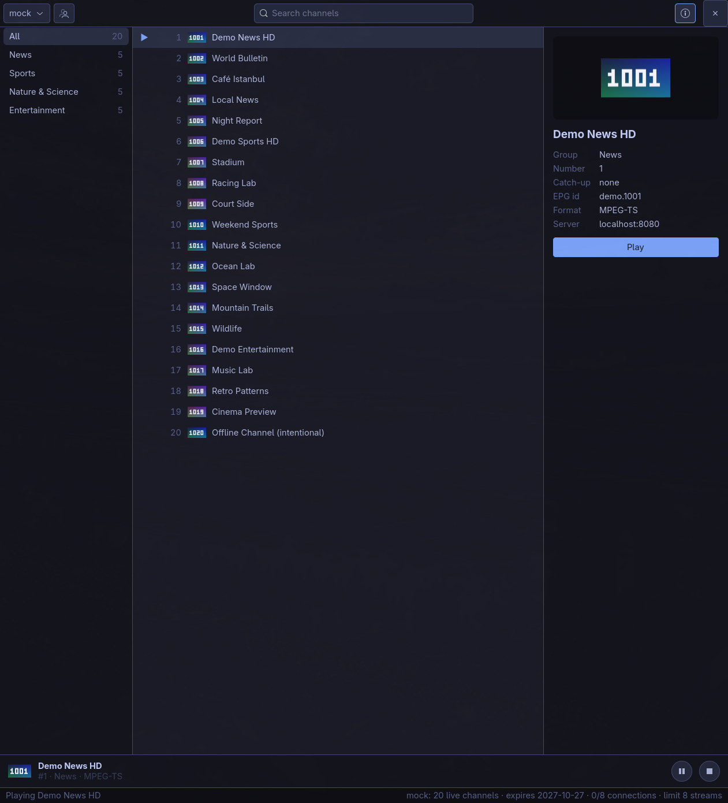
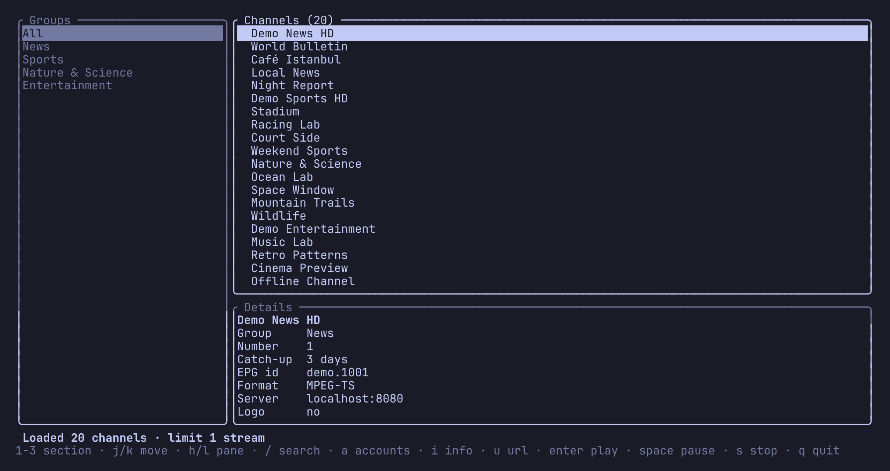

# Tuner

**A lean, Linux-native IPTV player written in Rust.**

Open a playlist, find a channel, and watch. Tuner pairs a keyboard-first
terminal interface with a native GTK4 desktop app. Both play streams with
[mpv](https://mpv.io): the desktop app shows the video right in its window,
the terminal app in mpv's own window. They share your accounts and settings.

```sh
tuner ~/Downloads/playlist.m3u
```



**[Try the interactive demo in your browser →](https://tuner-iptv.github.io/Tuner/)**

## Why Tuner

### Lean by design

Tuner compiles to native code with Rust. The terminal interface uses ratatui;
the desktop app uses GTK4. No Electron, web view, or background service.
Install just the terminal binary if that is all you need.

Tuner handles browsing and stream control; mpv handles video playback. Tuner
never decodes video itself. Your `mpv.conf` applies, including your
hardware-decoding settings.

### Video right in the window

The desktop app embeds mpv (libmpv): the video plays beside the channel list,
and the details panel steps aside while it does. Point at the video for
Tuner's own control bar, themed like the rest of the window:

- play/pause, ±10 s, a seek bar for movies and episodes, mute and volume
- **Audio & subtitles**: tracks listed by language, with codec, channels and
  Default/Forced flags
- **Stream info** badge (`1920×1080 · 25 fps · 4.2 Mb/s`) and mpv's own
  statistics overlay
- **Cinema mode** (video fills the window) and **fullscreen** (`F11` or
  double-click)
- **Open in mpv window**: moves the stream to a separate mpv window, keeping
  its tracks, volume and position, without opening a second connection

If libmpv or OpenGL can't start, the app falls back to mpv's own window. See
[embedded video](docs/gui.md#embedded-video).

### Open a playlist and watch

Open an M3U file or URL directly, without creating a Tuner account or writing
a config file. Bring your own playlist or provider login; Tuner does not
supply channels or subscriptions:

```sh
tuner https://example.com/playlist.m3u   # terminal
tuner-gtk ~/tv.m3u                      # desktop
```

Have an Xtream Codes login? Add it once in the desktop app and both
interfaces pick it up, with live TV, movies and series.

### At home on Linux

Use the terminal or a native GTK4 window. Both support keyboard navigation
and share the same accounts and settings. Native packages are available for
Debian/Ubuntu, Fedora, and Arch Linux; static terminal builds cover x86_64
and ARM64 Linux.

| Terminal (`tuner`) | Desktop (`tuner-gtk`) |
| ------------------- | ---------------------- |
|  |  |
| Vim-style keys, uses your terminal's colours | GTK4 window with channel logos, built-in themes and embedded video |

In the terminal, use `j`/`k` or the arrow keys to move, `/` to search,
`Enter` to play, and `q` to quit. In the desktop app, type to search, press
`Enter` to play, `F11` for fullscreen video, and `Ctrl+Q` to quit. See the full
[terminal](docs/keybindings.md) and [desktop](docs/gui.md#keys) shortcuts.

### Stream limits built in

Tuner coordinates local playback with per-account stream slots and checks
Xtream providers for active connections before starting another stream.
It warns or blocks according to your settings, and moving a stream from the
window to mpv's own window reuses its slot. Cross-device checks depend on the
provider's reporting; see [stream limits](docs/stream-limits.md).

Tuner redacts credentials from its logs and error messages, and can read
passwords from your password manager. Stream URLs contain credentials, so
treat mpv logs and watch history as sensitive. See [credentials](docs/sources.md#credentials).

## Install

Tuner needs **mpv** for playback (the desktop app also uses libmpv for its
embedded video); the packages below install both for you.
The distribution package is named `tuner-iptv`; the commands are `tuner`
and `tuner-gtk`.

### Ubuntu 24.04+ / Debian 13+

Download `tuner-iptv_…_amd64.deb` from the
[latest release](https://github.com/tuner-iptv/Tuner/releases/latest), then:

```sh
sudo apt install ./tuner-iptv_*_amd64.deb
```

### Fedora 40+

Download `tuner-iptv-….x86_64.rpm` from the
[latest release](https://github.com/tuner-iptv/Tuner/releases/latest), then:

```sh
sudo dnf install ./tuner-iptv-*.x86_64.rpm
```

### Arch Linux

Build the package from this repository so pacman can track it:

```sh
sudo pacman -S --needed base-devel git
git clone https://github.com/tuner-iptv/Tuner.git tuner
cd tuner/packaging/aur/tuner-iptv-bin
makepkg -si
```

Use `packaging/aur/tuner-iptv-git` instead to compile the latest source (x86_64
or ARM64).

Each package installs both `tuner` and `tuner-gtk`, and adds **Tuner** to
your app launcher.

<details>
<summary>Other distributions, or building from source</summary>

**Terminal-only static binary** (any x86_64 or ARM64 Linux; install mpv
yourself): download `tuner-tui-v…-<arch>-linux-musl.tar.gz` from the
[latest release](https://github.com/tuner-iptv/Tuner/releases/latest) and
copy the `tuner` binary onto your `PATH`.

**From source:** install [Rust 1.92+](https://rustup.rs), mpv, and the GTK 4
and libmpv development files (`libgtk-4-dev libmpv-dev` on Ubuntu,
`gtk4-devel mpv-devel` on Fedora, `gtk4 mpv` on Arch), then:

```sh
git clone https://github.com/tuner-iptv/Tuner.git tuner
cd tuner
cargo install --locked --path crates/tuner       # terminal
cargo install --locked --path crates/tuner-gtk   # desktop
```

Add `--no-default-features` to the desktop build for a GUI without embedded
video that always plays in mpv's own window (no libmpv needed to build).

More detail: [docs/packaging.md](docs/packaging.md).

</details>

## Usage

```sh
tuner playlist.m3u          # a playlist file or URL, no setup needed
tuner                      # your first saved account
tuner home                  # a saved account by name
tuner-gtk                   # the desktop app
```

Saved accounts live in `~/.config/tuner/config.toml`. The desktop app
manages that file for you (`Ctrl+,`), or you can edit it by hand:

```toml
[[source]]
name = "home"
type = "xtream"
server = "http://line.example.com:8080"
username = "myuser"
password_command = "pass show iptv/home"

[[source]]
name = "free"
type = "m3u"
location = "https://iptv-org.github.io/iptv/index.m3u"
```

- All options: [docs/sources.md](docs/sources.md)
- Keys: [terminal](docs/keybindings.md) · [desktop](docs/gui.md#keys)
- Themes: [docs/gui.md](docs/gui.md#theming)

## Roadmap

Next up: Stalker portals, favorites and history, and a TV guide (EPG) with
catch-up. See [docs/roadmap.md](docs/roadmap.md).

## Contributing

Start with [ARCHITECTURE.md](ARCHITECTURE.md) and
[docs/development.md](docs/development.md). AI coding agents: read
[AGENTS.md](AGENTS.md).

## License

[GPL-3.0-or-later](LICENSE).
