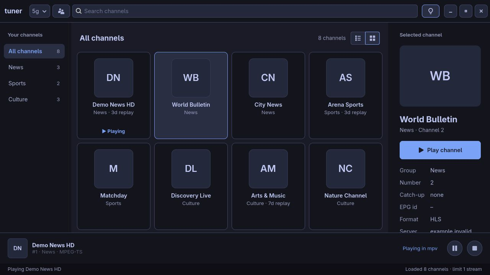

# GUI (`tuner-gtk`)

Tuner's native GTK4 desktop interface: browse channels in a window and watch
in mpv's separate window. Both the desktop and terminal interfaces share
accounts, settings, and playback control. Code: `crates/tuner-gtk`.
Decision record: [ADR 0006](decisions/0006-gtk4-gui.md). A browser mock of this
layout powers the project site's demo; see [website.md](website.md).

```sh
cargo run -p tuner-gtk                       # first configured source
cargo run -p tuner-gtk -- provider           # a [[source]] by name
cargo run -p tuner-gtk -- ~/list.m3u         # any M3U path/URL
```

With no accounts configured (and no argument) it opens on an **Add account**
screen instead of failing.

It takes the same arguments and the same `config.toml` as the TUI
([sources.md](sources.md)), and enforces the same
[stream limits](stream-limits.md) through the shared `tuner_app::Controller`.

Needs GTK ≥ 4.10 and libmpv at runtime (`pacman -S gtk4 mpv`; Ubuntu:
`libgtk-4-1 libmpv2`) and `libgtk-4-dev libmpv-dev` to build.

## Layout

```
┌ Tuner · account ▾ ⟳ ─── [ Search channels ] ─────────────────────────────────────┐
│Your channels   │All channels            20 channels    │Selected channel          │
│All channels 20 │1 [logo] Demo News HD       ▶ Playing  │[logo]                    │
│News          5 │         News · 3d replay              │Demo News HD              │
│Sports        5 │2 [logo] World Bulletin                │[▶ Play channel]          │
│                │         News                          │Format  MPEG-TS           │
├────────────────┴───────────────────────────────────────┴──────────────────────────┤
│ [logo] Demo News HD                                      Playing in mpv  ⏸  ⏹     │
│        #1 · News · MPEG-TS                                                        │
│ Last action                                         mock: 20 live · limit 1       │
└───────────────────────────────────────────────────────────────────────────────────┘
```

| Area        | Notes |
| ----------- | ----- |
| Header      | **Theme picker** (palette icon, right side; see [Theming](#theming)), one **account menu** (name and type of the open account) and a **Refresh** button. The menu's popover lists **My playlists** (click to switch; the open one is highlighted, long names wrap in full) followed by **Add or manage accounts** (the Accounts window has the **+** button). **Refresh** (`Ctrl+R` / `F5`) re-downloads the open playlist from the provider; it works for configured accounts and for a path/URL given on the command line. Refreshing and switching both stop playback, quit mpv and free the stream slot before loading, and return to Live. |
| Sidebar     | The **Live / Movies / Series** switch at the top (greyed out for sources without an Xtream login), then a heading and groups with counts; "All channels" first. For movies and series the groups are categories ("All movies", "All series"); inside a series they are its seasons. Selecting filters both channel views. Drag its divider to resize between 180 and 360 px. |
| Channel list| Group heading and filtered channel count; inside a series a **‹ Series** button before the title returns to the series list. Spacious two-line rows with number, framed logo, name, and group/replay metadata. Selection has a rounded highlight; the playing row has a separate `▶ Playing` / `Ⅱ Paused` label. Movies and episodes use the same rows (no channel number); series rows show `year · ★ rating`. An empty search shows a helpful message. Virtualised (`ListView`), fine with tens of thousands of channels. |
| Channel cards | Use the **List view** / **Cards view** buttons beside the channel count. Cards show larger logos, channel names, group/replay metadata and playing/paused indicators; columns reflow with the available width. Both views share the same selection, search, groups and playback controller. Switching views never restarts playback. The grid is virtualised (`GridView`). |
| Details     | "Selected channel" heading, larger logo, title and subtitle, prominent **Play channel** button (**Play movie** / **Play episode** / **Show episodes** for movies, episodes and series), then the same fields as the TUI's `i` pane (category, year, rating and plot for a series). The stream URL (it embeds the password) is hidden unless you press the **Show stream URL** toggle. |
| Player bar  | Slides up while something plays: framed logo, name, `#number · group · format`, **Playing in mpv** / **Paused** state, round **pause/resume** and **stop** buttons. Both the icon and state follow pauses in mpv's own window (checked every second). |
| Status bar  | Last action · update notice when a newer release exists, with a close button (ADR 0007) · source summary and stream limit. |

Logos are fixed-size icons (120 px in the details panel, 36 px in the list,
80 px in cards, 40 px in the player bar), so large logos or long names never
choose the layout width. Missing, loading or failed logos show channel initials
in the same frame.

Both sidebars have draggable dividers. Groups start at 200 px and allow
180–360 px; details start at 320 px and allow 260–440 px. The limits tighten
when necessary to reserve at least 300 px for the channel browser. Widths and
the selected view mode are kept for the current window, including account
switches; they are not saved between launches. Focus a divider with `Tab`, then
use Left/Right to resize in 10 px steps or Home/End to choose its limits.

Below 1000 px of content width the details pane collapses automatically to
leave room for browsing next to mpv. Widening the window restores it if the
details toggle is on; explicitly turning it off keeps it hidden. The pane
also stays hidden on the welcome, loading and error screens.



## Keys

| Key                     | Action                                   |
| ----------------------- | ---------------------------------------- |
| type anywhere           | search (focus jumps to the search box)   |
| `Enter` / double-click  | play selected channel                    |
| `Ctrl+1` / `2` / `3`    | Live / Movies / Series                   |
| `Alt+Left`              | back from a series' episodes             |
| `Ctrl+F`                | focus search                             |
| `Ctrl+P`                | pause / resume                           |
| `Ctrl+S`                | stop: quit mpv, free the stream slot     |
| `Ctrl+I`                | toggle details panel                     |
| `Ctrl+T`                | open the theme picker                    |
| `Ctrl+Q`                | quit (closes mpv)                        |
| `Ctrl+,`                | manage accounts                          |
| `Ctrl+O`                | open the account menu                    |
| `Ctrl+R` / `F5`         | refresh the open playlist                |

## Movies and series

Needs an Xtream login (or an M3U `get.php?username=…` link); see
[sources.md](sources.md#movies-and-series). The catalogues are large, so they
load the first time you open **Movies** or **Series** and are kept until you
switch account. The section opens at once and fills while it downloads: new
categories join the sidebar, counts grow, and entries matching the current
search and category are appended to the list without disturbing scrolling or
the selection. A small spinner next to the count shows it is still loading.
Live channels load the same way right after the login. Movies play like
channels. `Enter` on a series loads its episodes: the sidebar becomes the
seasons, and **‹ Series** in the list heading (or `Alt+Left`) returns to the series list. The list and sidebar fade in over
180 ms when the section or series changes (skipped when the desktop turns
animations off). Playback
carries on while you switch sections, and the stream slot is reused. Search
and the selected group reset when the list changes.

## Accounts window

Add, edit, test and remove accounts without touching `config.toml`:

- **Left:** accounts in config order; the first is the default (`tuner`
  with no argument opens it). **+** / `Ctrl+N` adds, **−** removes (with a
  confirmation), **Make default** moves the selection to the top.
- **Right:** name, type (Xtream Codes / M3U playlist), server, username,
  password *or* password command, playlist URL/file, max streams (0 = the
  provider's limit), and what to do when the account is full (ask / never
  play).
- **Test login** (`Ctrl+T`) logs in / fetches the playlist on a worker thread
  without saving and shows e.g. `✓ Works: 20 live channels · expires … ·
  0/8 connections`, or the error.
- **Save** (`Enter`, `Ctrl+S`) validates (required fields, unique name,
  exactly one of password / password command), writes the config and, if the
  edited account is the open one, reloads it.

Saving goes through `tuner_app::Config::save`: atomic write, mode `600`,
previous file kept as `config.toml.bak`. Comments in a hand-edited file are
not preserved. The list never shows passwords or `get.php` query strings.

Form fields are labelled for screen readers (`LabelledBy` relations), which
also lets UI tests drive the window through AT-SPI.

## Stream limits

Identical rules to the TUI. A blocked start shows a "Stream limit reached"
dialog; a full or unverifiable account shows a "Stream limit" dialog with
**Cancel** (default) and **Play anyway**. Closing the window quits mpv and
releases the slot.

## Theming

By default the GUI uses your own theme file, `theme.toml` next to
`config.toml` (usually `~/.config/tuner/theme.toml`). `theme.rs` turns it
into CSS for our widgets and installs it at application priority. Directory
monitors reload it when the file changes, so the window recolours live. With
no file (or an unreadable one) the built-in Tokyo Night palette is used.

The file is a flat list of hex colours. `background` and `foreground` are
required; every other key falls back to a related colour:

```toml
mode = "dark"                 # or "light"
background = "#1a1b26"
foreground = "#a9b1d6"
accent = "#7aa2f7"            # highlights, playing channel, focus rings
selection = "#292e42"         # selected row
muted = "#414868"             # borders, scrollbars
dark_background = "#13141c"   # header, sidebar, details
darker_background = "#0e0e14" # status bar
lighter_background = "#24283b" # hover, entries, buttons
bright_foreground = "#c0caf5" # titles
yellow = "#e0af68"            # warnings
red = "#f7768e"               # errors
```

To follow a desktop theme that writes a palette in this format, symlink it:
`ln -s /path/to/colors.toml ~/.config/tuner/theme.toml`. When the file is a
symlink, the GUI also watches the target's directory and its parent, so tools
that rewrite the target or swap out the whole theme directory are picked up.
Restart the GUI after creating the symlink.

- Only `#hex` values are accepted, so a theme file can't inject CSS.
- We don't use libadwaita: it ignores custom themes.

### Built-in themes

To pick a built-in theme instead, use the **theme picker** in the header
(palette icon, `Ctrl+T`). Choosing a row recolours the window at once and
saves the choice to `config.toml`; **Custom (theme.toml)** goes back to the
default and removes the setting. The status bar
says if saving failed (the theme still applies for this session).

You can also set it yourself, in `config.toml` or on the command line;
`--theme` wins over the config for that launch:

```toml
theme = "catppuccin-mocha"      # top level, before any [section]
```

```sh
tuner-gtk --theme nord
tuner-gtk --list-themes         # print the names and exit
```

| Family      | Names |
| ----------- | ----- |
| Tokyo Night | `tokyo-night`, `tokyo-night-storm`, `tokyo-night-moon`, `tokyo-night-day` (light) |
| Catppuccin  | `catppuccin-mocha`, `catppuccin-macchiato`, `catppuccin-frappe`, `catppuccin-latte` (light) |
| Gruvbox     | `gruvbox-dark`, `gruvbox-light` |
| Rosé Pine   | `rose-pine`, `rose-pine-moon`, `rose-pine-dawn` (light) |
| Solarized   | `solarized-dark`, `solarized-light` |
| Others      | `nord`, `dracula` |

`custom` (also what you get with no setting) uses the theme file. Names ignore
case, and `_` or spaces work like `-`. An unknown name is an error at startup
that lists the valid ones. A built-in theme is fixed: changes to the theme
file no longer recolour the window until you pick **Custom (theme.toml)**
again. Saving
rewrites the config like the accounts window does (comments are not kept, the
old file becomes `config.toml.bak`). The terminal app (`tuner`) ignores `theme`; it
uses your terminal's palette.

Palettes live in `themes.rs`, one `Builtin` per theme, mapped onto the same
`Palette` fields the theme file fills. To add one, append an entry; the unit
tests check that every colour is valid hex and that text, selected rows and
accent buttons stay readable (WCAG contrast). Catppuccin uses its Mauve as
the accent, the rest use their usual blue or purple.

## Threads

GTK runs on the main thread. Anything that can block (loading the source,
the provider's connection check, starting mpv, logo downloads) runs on GIO's
blocking pool (`gio::spawn_blocking`) and resumes on the main loop
(`glib::spawn_future_local`). Channel lists and catalogues stream in batches
from the worker over a channel; the main loop picks them up every 120 ms
(`BATCH_INTERVAL`), merging whatever arrived into one small update, so the UI
never stalls on a single huge refresh. Until the first batch arrives it looks
sooner (4 ms, doubling up to the interval), so a local playlist is on screen
without waiting a full interval. The `Controller` lives in an
`Arc<Mutex<…>>`; a 1 s timer uses `try_lock` to notice a closed mpv window
without ever blocking the UI.

## Embedded video

By default (cargo feature `embedded`, needs libmpv and libEGL), the video
plays inside the window,
right of the channel list, in a pane that shows only while something plays
and takes the window's extra width. Drag the divider to resize it. The
details panel closes while the video is open, to give it room (`Ctrl+I`
still opens it), and comes back when the video closes.

Moving the pointer over the video fades in tuner's control bar over a
gradient (themed like the rest of the window): a slim seek bar across the
top that thickens on hover, then playback, volume and time on the left and
the view controls on the right. It fades out again after 2.5 s:

| Control                  | mpv command                                  |
| ------------------------ | -------------------------------------------- |
| Play/pause               | `cycle pause`                                |
| Back / forward 10 s      | `seek -10` / `seek 10`                       |
| Seek bar (movies, episodes; hidden for live) | `seek <s> absolute`      |
| Mute, volume (0–130)     | `cycle mute`, `set volume <n>`               |
| Audio & subtitles        | `set aid <id>`, `set sid <id>` / `set sid no`, from `track-list` |
| Stream info              | badge: `video-params/w`×`h`, `container-fps`, `video-bitrate` |
| Statistics               | `script-binding stats/display-stats-toggle` (mpv's own overlay) |
| Open in mpv window       | replays the stream in mpv's own window       |
| Cinema mode              | tuner only: video fills the window           |
| Fullscreen               | `cycle fullscreen`                           |

**Audio & subtitles** opens one menu with the stream's audio tracks and
subtitle tracks side by side. Each row shows the language by name
(`tur` → Turkish) with the title, codec, channels and Default/Forced flags
below it; the playing track is ticked. **Statistics** toggles mpv's stats
overlay, exactly as `i` does in mpv (page 1; its other pages need mpv's
number keys, which stay with tuner). **Stream info** (eye icon) instead
keeps a small badge in the video's top-left corner, such as
`1920×1080 · 25 fps · 4.2 Mb/s`, with the same values the stats overlay
shows, updated live; it stays up while the control bar fades.

The bar follows mpv's own state (observed properties), so a pause from the
player bar or a media key shows on it too. Double-click toggles fullscreen
and the wheel seeks (mpv's default mouse bindings).

**Fullscreen** (button, double-click, `F11` while a video shows): the window goes fullscreen
showing only the video and its control bar. `Esc` or `F11` leaves it, and
`Space` pauses while in it. Leaving fullscreen through the window manager
works too.

**Cinema mode** (like YouTube's theater mode) hides the sidebar, channel
list, details panel, player bar and status bar so the video fills the
window, keeping the header and the window size. `Esc` or the button leaves
it, and it ends by itself when playback stops.

**Open in mpv window** moves the playing stream to a separate mpv window:
the embedded stream is stopped first, then the same URL replays in mpv (a
movie or episode continues at the same position; it is fetched once more),
through the controller like a channel switch (the stream slot is kept, and
only one stream is ever open). The stream stays there while you zap; close
the mpv window to bring the next stream back into tuner.

tuner's own mpv settings (`vo=libmpv`, its IPC socket, no OSC) are set
again after libmpv reads `mpv.conf`, so lines like `vo=gpu-next` there
don't break the embedded view. If something makes the embedded mpv quit
(MPRIS Quit, a script), tuner plays in an mpv window from then on.

Built with `--no-default-features`, or if libmpv or OpenGL
fails to start (the reason goes to stderr), mpv opens its own window as
usual.

libmpv reads your `mpv.conf`, and the config's `[mpv] args` and
`--mpv-arg` apply as `--key=value`, `--flag` or `--no-flag`. Control still
goes over mpv's JSON IPC (libmpv's own IPC server), so pause, stop, stream
limits and load errors behave as with the external window. The C calls live
in `src/embed.rs`, the crate's only `unsafe` code; see
[ADR 0008](decisions/0008-embedded-video.md).

## Desktop entry

`packaging/tuner-gtk.desktop` makes Tuner show up in your desktop's app launcher:

```sh
cargo install --path crates/tuner-gtk
install -Dm644 packaging/tuner-gtk.desktop ~/.local/share/applications/tuner-gtk.desktop
install -Dm644 packaging/io.github.tuner_iptv.Tuner.svg ~/.local/share/icons/hicolor/scalable/apps/io.github.tuner_iptv.Tuner.svg
```

## Catch-up (replay)

Some providers record channels for a few days. The list shows a
`3d replay` subtitle and the details panel a *Catch-up* value for those
channels. tuner shows this but cannot play from the archive yet: that needs
a start time (Xtream's timeshift URL) and, to be usable, the programme guide.
It is planned with the EPG; see [roadmap.md](roadmap.md).

## Not yet

- Remembering the scroll position when going back from a series.

- mpv's keyboard shortcuts in the embedded video (keys stay with tuner).
- Favorites, EPG. See [roadmap.md](roadmap.md).
